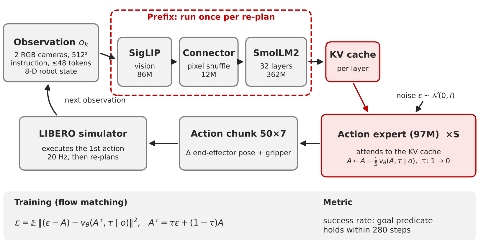

# Efficient SmolVLA Replanning on a Tesla T4

**A paired study of inference latency and closed-loop success on LIBERO-Spatial**

[Research report](paper/main.pdf) · [Supplement](docs/report_appendix.pdf) · [Kaggle notebook](notebooks/kaggle_efficient_vla.ipynb) · [Literature matrix](deliverables/literature_matrix.xlsx)

How much can we reduce the cost of a SmolVLA replan while preserving task success? This study profiles the released checkpoint on a Tesla T4, then evaluates cheaper inference and reduced observation refresh on matched simulation episodes. All variants use the same pretrained weights. [SmolVLA paper](https://arxiv.org/abs/2506.01844)

| **789 → 112 ms** | **862 → 114 ms** | **75.4% → 78.4%** |
| :---: | :---: | :---: |
| Median isolated replan, 3-step FP16 + CUDA graph | Median in-loop replan, same configuration | Closed-loop success, 3-step FP16 eager, 500 matched episodes |

## Benchmark results

### Replan latency

Isolated batch-1 latency is p50 over 60 timings per configuration. In-loop latency is the median of episode-level p50s across 20 episodes per configuration. Both report policy replanning time in milliseconds.

| Execution | Euler steps | Isolated p50 | Isolated speedup | In-loop p50 |
|:--|--:|--:|--:|--:|
| Released precision, eager | 10 | 789.2 | 1.0× | 862.1 |
| FP16, eager | 3 | 245.2 | 3.2× | 274.6 |
| FP16, CUDA graph | 3 | **111.9** | **7.1×** | **114.0** |
| FP16, CUDA graph | 2 | 103.2 | 7.6× | — |
| FP16, CUDA graph | 1 | **93.3** | **8.5×** | — |

The component profile points to two T4 bottlenecks, bfloat16 execution and kernel launch overhead in the flow loop. CUDA graph replay preserved the first action and success outcome in all 20 checked episodes. Entire trajectories matched in 10 episodes, the same count as a repeat of eager execution. [Isolated timings](results/t4/profile/graph_t4.json) · [Component profile](results/t4/profile/profile_t4_v2.json) · [In-loop data](results/t4/latency/)

### Closed-loop success

Each comparison pairs a variant with the released policy on the same LIBERO-Spatial task and initial state. The success-rate difference (Δ) and paired Newcombe 95% confidence interval are in percentage points. Non-inferiority requires the lower bound to exceed the prespecified −5-point margin. Success rates use eager execution.

| Variant | Initial states | Pairs | Released | Variant | Δ [95% CI] |
|:--|:--|--:|--:|--:|:--|
| Open loop, 5 actions per plan | 0–19 | 200 | 77.0% | 64.5% | −12.5 [−20.3, −4.5] |
| Open loop, 10 actions per plan | 0–19 | 200 | 77.0% | 67.5% | −9.5 [−17.3, −1.6] |
| Open loop, 5 actions with gripper-event replanning | 0–19 | 200 | 77.0% | 65.0% | −12.0 [−18.7, −5.2] |
| Stale image, up to 5 steps, 3 Euler steps | 0–19 | 200 | 77.0% | 65.0% | −12.0 [−19.1, −4.7] |
| Released precision, 3 Euler steps | 0–19 | 200 | 77.0% | 79.0% | +2.0 [−3.8, +7.8] |
| FP16, 3 Euler steps | 0–19 | 200 | 77.0% | 77.0% | 0.0 [−5.8, +5.8] |
| FP16, 2 Euler steps | 0–19 | 200 | 77.0% | 77.5% | +0.5 [−5.7, +6.7] |
| FP16, 1 Euler step | 0–19 | 200 | 77.0% | 79.5% | +2.5 [−4.2, +9.2] |
| FP16, 3 Euler steps, fixed noise per episode | 0–19 | 200 | 77.0% | 23.5% | −53.5 [−60.3, −45.4] |
| **FP16, 3 Euler steps, pooled** | 0–49 | 500 | 75.4% | **78.4%** | **+3.0 [−0.6, +6.6]** |
| FP16, 3 Euler steps, added states only | 20–49 | 300 | 74.3% | 79.3% | +5.0 [+0.3, +9.7] |
| **FP16, 1 Euler step, confirmation** | 20–49 | 300 | 74.3% | **80.3%** | **+6.0 [+0.6, +11.4]** |

The pooled 3-step result and the 1-step confirmation both clear the non-inferiority margin. The 3-step study expanded to states 20–49 after the 200-pair interim analysis. The 1-step confirmation was specified before its run on those 300 pairs. Its task-cluster bootstrap interval (−1.0 to +12.7 points) illustrates uncertainty across tasks. The analysis also reports exact McNemar tests with Holm adjustment for the nine comparisons on states 0–19. These results cover one checkpoint, one simulated task suite, and one GPU model. [Episode CSVs](results/t4/raw/) · [Computed statistics](results/t4/report_numbers.json)

## Experimental design

- **Policy and environment.** LeRobot v0.6.1, checkpoint `HuggingFaceVLA/smolvla_libero`, and 10 LIBERO-Spatial tasks. Each episode uses a deterministic environment seed. Replanning at the same step uses common random numbers across variants, except in the fixed-noise probe. [Checkpoint](https://huggingface.co/HuggingFaceVLA/smolvla_libero)
- **Inference ablations.** Change precision, reduce the number of Euler steps, or capture the flow loop with a CUDA graph. Compare these changes with action chunking, gripper-triggered replanning, and stale-image reuse.
- **Offline probes.** Measure action sensitivity to flow noise and calibrate warm-started integration against a cold start. The calibration did not justify a closed-loop warm-start run. [Supplement](docs/report_appendix.pdf)

## Reproduce the results

### CPU analysis of the committed data

From the repository root, install the analysis dependencies and write derived results to a separate directory.

~~~bash
python -m pip install -r requirements.txt
mkdir -p /tmp/efficient-vla
PYTHONPATH=src python -m evla.analyze --root results/t4/raw --out /tmp/efficient-vla/summary.json
PYTHONPATH=src python scripts/report_numbers.py --out /tmp/efficient-vla/report_numbers.json
PYTHONPATH=src python -m pytest -q tests
~~~

### GPU profiling and rollout evaluation

Use the [Kaggle notebook](notebooks/kaggle_efficient_vla.ipynb) with Internet enabled and the **GPU T4 x2** accelerator. Recorded runs used Python 3.13, PyTorch 2.11.0 with CUDA 12.8, LeRobot v0.6.1, and MuJoCo 3.3.7. The setup script constrains MuJoCo to `>=3.3,<3.4` because initial states for LIBERO-Spatial task 5 settle differently from 3.4 onward. It also configures headless EGL rendering.

~~~bash
git clone https://github.com/Akgithub2028/Efficient-SmolVLA.git efficient-vla
cd efficient-vla
bash scripts/kaggle_setup.sh

mkdir -p /kaggle/working/results
PYTHONPATH=src python -m evla.profile --out /kaggle/working/results/profile_t4.json
PYTHONPATH=src python -m evla.bench_graph --out /kaggle/working/results/graph_t4.json

# Run the v6 evaluation queue and monitor progress in a separate cell.
bash scripts/bg.sh /kaggle/working/results/queue.log \
  bash scripts/run_queue.sh scripts/queues/queue_spatial_v6.txt
python scripts/monitor.py /kaggle/working/results/raw
~~~

The queue above is one stage of the study. The [run manifest](scripts/queues/README.md) maps experiments to queues, direct launches, and report sections. Interrupted runs skip finished episodes recorded in the output CSVs or provided via `--skip-from`.

## Repository map

| Path | Role |
|:--|:--|
| [`src/evla/`](src/evla/) | Policy loading, inference variants, resumable rollout runner, profiling, and paired statistics |
| [`scripts/`](scripts/) | Kaggle setup, sharded runs, monitoring, reporting, and figure generation |
| [`results/t4/`](results/t4/) | Episode outcomes, action traces, selected videos, profiles, and run logs |
| [`paper/`](paper/) · [`docs/`](docs/) | Research report, supplement, and LaTeX sources |
| [`deliverables/`](deliverables/) | Literature matrix and its source data |
| [`tests/`](tests/) | CPU tests for analysis and inference utilities |

## Citation and license

Aayaann Kausar. *Efficient SmolVLA Replanning on a Tesla T4*. 2026. [Research report](paper/main.pdf) · [GitHub profile](https://github.com/Akgithub2028)

Repository code is released under the [MIT License](LICENSE). SmolVLA, LeRobot, and LIBERO retain their original licenses.
